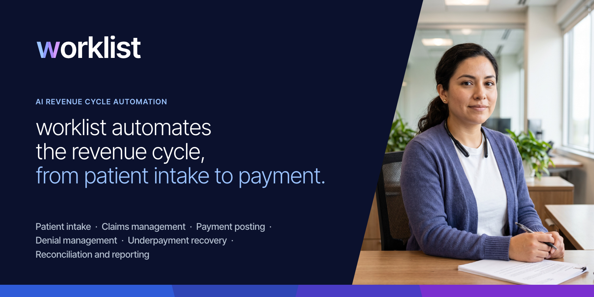
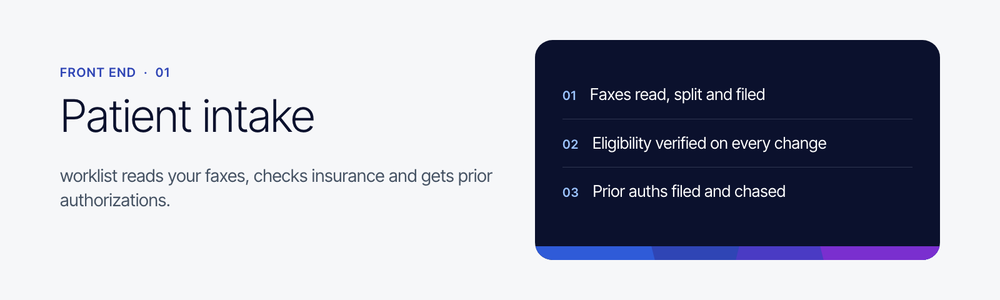
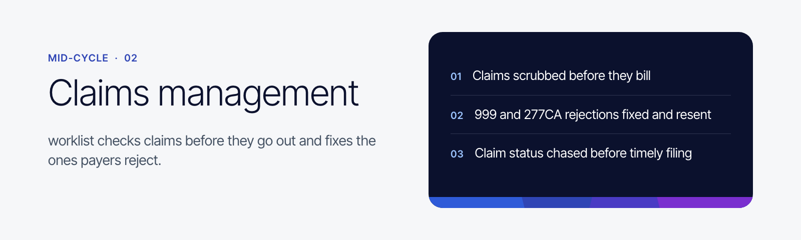
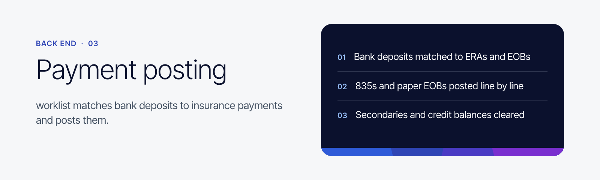
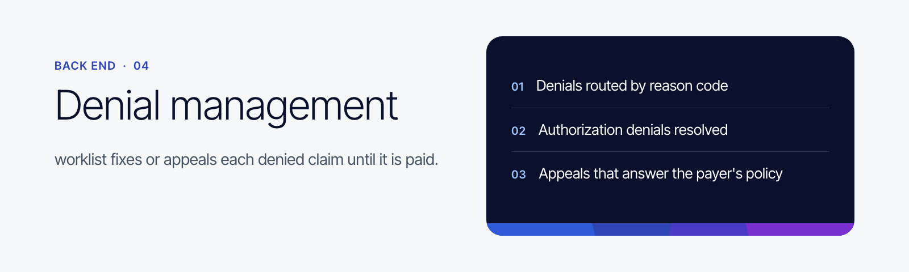
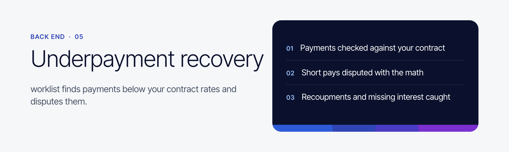
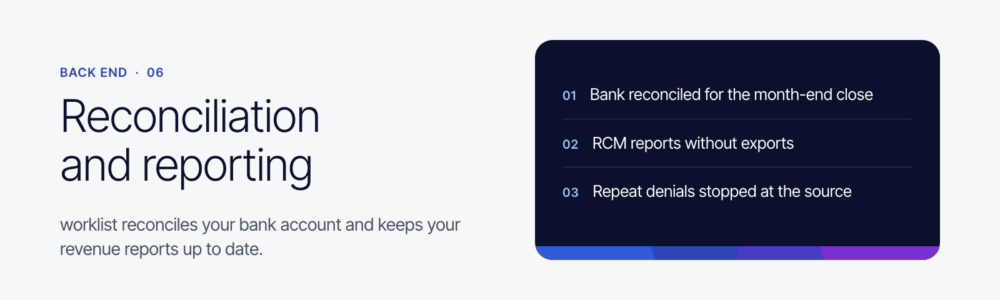

<h1 align="center">worklist: AI revenue cycle automation, from intake to payment</h1>

  worklist automates the revenue cycle for healthcare providers with AI. 
  It checks eligibility, gets prior authorizations, fixes claims, posts payments, appeals denials and disputes underpayments. 
  Your team steps in only when a decision needs a person.

  
  &nbsp;
  

## How worklist works

- **Routine work runs on its own**, before anyone on your team logs in.
- **Your rules decide** what runs alone and what waits for a person's approval.
- **worklist works inside the systems you already use.** It reads from your EHR or billing system, writes the result back and checks that the write landed.
- **Deadlines are tracked and follow-ups are sent**, so no claim runs past a payer's filing limit.

 

## Patient intake: referrals, eligibility and prior authorization

worklist reads your faxes, checks insurance and gets prior authorizations, so your intake team starts with patients who are ready.

- **Faxes read, split and filed:** faxes, emails and uploads classified, split into documents, matched to the right patient and filed in your system.
- **Eligibility verified on every change:** benefits checked the moment a patient is matched, and again whenever coverage changes.
- **Prior authorizations filed and chased:** submitted on the payer portal and followed to a decision. Missing signatures and records requested from the practice.

[Everything patient intake does &rarr;](https://worklist.health/solutions/patient-intake/)

 

## Claims management: claim scrubbing, rejections and claim status

worklist checks claims before they go out and fixes the ones payers reject.

- **Claims scrubbed before they bill:** missing values, payer rules and coding problems caught before the claim leaves.
- **999 and 277CA rejections fixed and resent** without anyone retyping a field.
- **Claim status chased:** 276/277 status checks on each payer's schedule, and escalation before a filing limit runs out.

[Everything claims management does &rarr;](https://worklist.health/solutions/claims-management/)

 

## Payment posting: ERA and EOB posting and deposit matching

worklist matches bank deposits to insurance payments and posts them to each claim.

- **Bank deposits matched to ERAs and EOBs** by trace number. Money without a remittance, or a remittance without money, is flagged and researched.
- **835s and paper EOBs posted line by line**, with adjustments mapped to your codes and every posting verified.
- **Secondaries and credit balances cleared:** secondary claims sent when the primary pays, credit balances refunded with your approval.

[Everything payment posting does &rarr;](https://worklist.health/solutions/payment-posting/)

 

## Denial management: denials, appeals and corrected claims

worklist fixes or appeals each denied claim until it is paid. Nothing is written off unless your rules allow it.

- **Denials routed by reason code:** from the remittance, a 277 or a payer letter, each denial is classified and sent to the right fix the day it arrives.
- **Authorization denials resolved:** the authorization found on the payer portal or requested from the ordering office, then the claim corrected or appealed.
- **Appeals that answer the payer's policy:** every note, record and claim line read, and each of the payer's criteria answered with the page that proves it.

[Everything denial management does &rarr;](https://worklist.health/solutions/denial-management/)

 

## Underpayment recovery: contract variance, payer disputes and recoupments

worklist finds payments below your contract rates and disputes them.

- **Payments checked against your contract:** allowed amounts compared line by line to your fee schedules, with units, modifiers and sequestration.
- **Short pays disputed with the math:** each dispute sent with the contract clause and the calculation, then followed up until the money arrives.
- **Recoupments and missing interest caught:** takebacks traced to the original claim and contested inside the payer's window.

[Everything underpayment recovery does &rarr;](https://worklist.health/solutions/underpayment-recovery/)

 

## Reconciliation and reporting: bank reconciliation and month-end close

worklist reconciles your bank account and keeps your revenue reports up to date.

- **Bank reconciled for the month-end close:** every deposit tied out, unposted remittances and unapplied cash listed, and the period locked once a manager signs off.
- **RCM reports without exports:** payments, denials, recoupments and write-offs by payer and reason.
- **Repeat denials stopped at the source:** a denial that keeps coming back is flagged, its cause found and a check added before the next claim bills.

[Everything reconciliation and reporting does &rarr;](https://worklist.health/solutions/reconciliation-and-reporting/)

## Who worklist is for

- [DME and HME suppliers](https://worklist.health/for/dme-hme-suppliers/): denials, appeals and records requests, inside Brightree.
- [Billing and RCM companies](https://worklist.health/for/billing-companies/): one worklist across every client you serve.
- [Physician groups and specialty practices](https://worklist.health/for/physician-groups/): intake, eligibility and prior authorization before the visit.
- [Digital health companies](https://worklist.health/for/digital-health/): a billing system of record, built as workflows.
- [Home health and labs](https://worklist.health/for/home-health-and-labs/): orders, eligibility and follow-up at volume.

## Pricing

worklist charges for what it works, with no seats and no minimums. Prices drop with volume.

| What | Price |
|---|---|
| A claim worked in a month | $1.00, down to $0.50 |
| An appeal sent to a payer | $5.00, down to $3.50 |
| Setting up a workflow for your payers and systems (one time) | $500 |

## Questions providers ask

**Does worklist replace our EHR or billing system?** 
No. worklist works inside the systems you already use. It reads from them, writes the result back and reads it again to confirm the write landed.

**What happens when the AI is unsure?** 
It says so. Every extracted value carries a confidence, and anything uncertain goes to a person with the source page highlighted. Nothing uncertain is written to your system.

**Does worklist submit claims itself?** 
Claims go out through your billing system and clearinghouse, as they do today. worklist decides when a claim is ready, fixes it and follows it until it is paid.

**How does worklist connect to our bank account?** 
Through a bank feed, or with BAI2, CSV statement and lockbox files where you have them. Deposits are matched to remittances by EFT trace number.

**What counts as a claim worked?** 
A claim that automation or a person worked on during the month: checked, submitted, followed up, posted or closed. It counts once that month, however many steps it took.

**How am I invoiced?** 
Monthly, in arrears, for what was used. There is no prepaid balance, and work never stops because of a balance.

 

  <a href="https://worklist.health">worklist.health</a>
  &nbsp;&middot;&nbsp;
  <a href="mailto:hello@worklist.health">hello@worklist.health</a>
  &nbsp;&middot;&nbsp;
  <a href="https://worklist.health/security/">Security</a>
  &nbsp;&middot;&nbsp;
  <a href="https://worklist.health/glossary/">RCM glossary</a>

